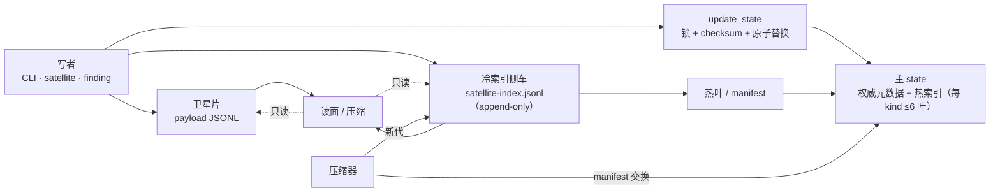

# ZTHL Aegis (智御)

[English](README.en.md) · **中文**

> 项目名：**ZTHL Aegis**（智御）；可安装的技能/包目录沿用历史名 `spz-gatekeeper-r-sequence`。

---

面向 AI 辅助软件工程的**确定性治理层**。它把「agent 说做完了」变成一组**第三方可复跑**的检查：
每一次阶段推进、编辑、派发与裁决，都由一个命令行工具把关，并写下**带签名、可回放**的记录。

本仓是公开发布通道。文档索引见 [`references/README.md`](references/README.md)，所有导出的文档都由它链接。

**移动端 / 抓取入口**：[文件地图](FILES.md)（全量路径 + 一句说明）· [llms.txt](llms.txt)（精选索引）。
两者由 `scripts/gk_repo_index.py` 生成，`gk_release_preflight` 的 `repo_index` 项守漂移。

### 许可

木兰宽松许可证第 2 版（Mulan PSL v2）。双语全文见 [`LICENSE`](LICENSE)，中文正本见
<http://license.coscl.org.cn/MulanPSL2>。

- 版权人：**Pu Junhan**（2026），完整声明块在 [`LICENSE`](LICENSE) 末尾。
- 随包分发的第三方组件（当前为 Apache ECharts 5.6.0）的许可见
  [`THIRD_PARTY_NOTICES.md`](THIRD_PARTY_NOTICES.md) 与 [`THIRD_PARTY_LICENSES/`](THIRD_PARTY_LICENSES/)。

### 个人独立作品声明

本仓是 **Pu Junhan** 的个人独立作品，仅代表个人观点与技术实践，不代表任何雇主、客户或组织的立场。
开发过程中未使用任何雇主/客户的专有代码、机密信息或资源；第三方依赖与参考实现均按其许可证使用，
并在 [`THIRD_PARTY_NOTICES.md`](THIRD_PARTY_NOTICES.md) 与 [`references/`](references/) 中标注。
本仓不构成商业承诺、法律意见，也不构成对任何第三方系统的授权。

### 用途与使用边界（负责任使用声明）

本仓是**软件开发过程的治理与审计工具**，设计用途仅限：授权范围内的自研/受托软件工程的流程门禁、
审计留痕与质量复核。

**明确禁止**：将本项目或其任何组件用于未经授权的系统入侵、绕过他人访问控制、恶意载荷投递、
隐藏持久化、规避安全审计，或任何违法用途。项目内置的拦截/检测能力用于**防御自身工程链路**，
不提供攻击能力，也不构成对任何系统的授权。

**责任边界**：

- 不做任何形式担保（见 Mulan PSL v2 免责条款）；部署、配置与使用后果由使用者自行负责。
- 不构成法律、合规或安全认证意见；合规要求请咨询具备资质的第三方。
- 默认配置**不是**安全加固基线；生产部署须自行完成威胁建模、最小权限与密钥管理。
- 本项目不针对第三方系统做主动探测/扫描，也不得被改造用于此类用途。

**负责任披露**：发现安全问题请**不要**公开提交 issue，先按 [`SECURITY.md`](SECURITY.md) 私下联系维护者；
我们会确认、修复并在修复后协调披露。恶意利用报告与自动化攻击载荷不在受理范围。

**AI 能力边界**：评审/分诊等辅助能力**只给建议、不改判定**（advisory only）；「论文写作投稿前置
模拟评审」是**投稿前自检**，不产出审稿意见、不替代任何会议的评审流程。

### 它做什么

- **阶段门**：工作沿显式阶段推进（`discover` → `guard-edit` → `advance`），越阶段编辑是**拒绝**，
  不是警告。
- **编辑预算**：按会话/阶段分配额度（余弦调度）+ 单文件上限，**落盘前**执行。
- **审计与 finding**：缺陷带 id、关闭判据与证据链登记；关闭必须引用工具可验证的来源。
- **状态压缩**：长寿命 state 拆成小的元数据头 + append-only 卫星片，每片单写者、读侧做并集。
- **交叉审查**：评审与计划质询走受约束的子代理通道（token/条数预算），而不是不受约束的对话调用。

### 元数据路由（DAG）

主 state 的元数据路由是**单向 DAG**：写者只经网关落主 state；卫星写者先落片/侧车，再以
manifest/热叶汇入；读面只读，压缩器只换代。这里没有「读面回写 state」的环。



**无环保证**：`写 → 网关 → state` 与 `片/侧车 → 压缩 → manifest` 两条支路只在 state 汇合；
读面没有回写边。**崩溃安全**：先片/侧车、后 manifest；交换前的旧状态始终完整。

### 目录结构

| 路径 | 用途 |
|---|---|
| `gatekeeper-cli.sh` | 确定性 CLI：state、门禁、审计、评审、finding、cron |
| `scripts/` | CLI 背后的 Python 模块（每个都有配对的 `test_*.py`） |
| `references/` | 按需加载的协议与阶段参考；索引见 [`references/README.md`](references/README.md) |
| `monitor-schemas/` | monitor 输出的 schema |
| `assets/`、`zthl/` | 运行时资产与可选的 harness 集成 |
| `install.sh`、`uninstall.sh` | 非破坏安装到 `.trae/skills/` |

### 支持的插件（加载安全网）

插件加载安全网 = `scripts/gk_plugin_manifest.py`：**未登记 id 不可加载**；`disabled` 拒绝；
`write=True` 必须声明 `undo`（无逆写效应直接拒）；`npm:` 源必须带 tarball `integrity`
（供应链 pin）；每次能力调用过 `check_capability` 白名单；加载/卸载带快照与回滚。
声明面同时做类型校验：`id` 必须等于注册键、`write`/`disabled` 必须是 bool、`undo`/`integrity`
不得为空白、`intercept` 必须是名单序列（字符串会被子串命中）；`get_manifest()` 返回副本，
能力查询对非法 manifest **零授权**。红队判据见 `scripts/test_gk_plugin_manifest_redteam.py`（G1–G12）。

本仓登记 **3 个**插件；**公开包自带 `bashpy-migrate` 的本体 wheel + 加载器**（包内优先）。
另两个依赖外部源：
`paper-review` 源码在私仓（导出排除面）、`git-workflow` 是同级独立技能 ⟹ 两者**载体不在场时
manifest 不登记**（避免“已登记但缺件”）。

| 插件 id | 名称 / 来源 | 源码仓库 | 本包内的形态 | 能力白名单 |
|---|---|---|---|---|
| `paper-review` | `gk_paper_review`（builtin；论文写作投稿前置模拟评审——投稿前自检，非同行审稿） | 无公开仓（私仓，含评审口径档案） | **私仓内置**；公开包不随附（源码在导出排除面）⟹ 命令入口返回加载安全网 `source=missing` | `paper-review` |
| `bashpy-migrate` | `zthl-bashpy-migrate`（pip / npm 包装） | [zthl-harness/zthl-bashpy-migrate](https://github.com/zthl-harness/zthl-bashpy-migrate) | **随包 wheel** `vendor/bashpy/*.whl`（SHA256 校验、包内优先；zipimport 免安装）+ 加载器 `scripts/gk_bashpy_loader.py`；pip / npm 仍可作外部源 | `analyze` `verify` `audit` `status` `check` `upgrade` `rollback` |
| `git-workflow` | 独立技能（MulanPSL-2.0） | [spz-ecosystem/git-workflow](https://github.com/spz-ecosystem/git-workflow) | 加载器在技能侧 `../git-workflow/scripts/gk_gitworkflow_loader.py` | `push` `branch` `worktree` `release` `security` `cleanup` `history` `selfcheck` `version` |

**不在插件安全网内**：`doc-align` 是 CLI 子命令（`_CMD_REG[doc-align]`，0 API 静态扫描），
不是插件；`migrate` / `paper-review` 的**命令入口**同样在 `_CMD_REG`。插件 manifest 只管
「能否加载 + 能力白名单 + 卸载回滚」，不管命令路由。

**开源面**：公开包随附 `bashpy-migrate` **本体**（`vendor/bashpy/zthl_bashpy_migrate-*.whl`）与加载器
（`scripts/gk_bashpy_loader.py`：包内 wheel 优先，SHA256 由同目录 `SHA256SUMS` 校验，校验不过即拒绝该源）；
上游 pip / npm 仍可用作外部源；`paper-review` 源码在私仓（`gk_paper_review.py` / `_loader.py` 在导出排除面）；
`git-workflow` 是独立技能（[spz-ecosystem/git-workflow](https://github.com/spz-ecosystem/git-workflow)），
加载器在技能侧。`paper-review` 与 `git-workflow` 都是**载体不在场即不登记**，不会留下指向缺件的登记项。

### 安全网与模板（概览与来历）

本仓的**模板**是可复制的产物骨架，**安全网**是进入节点 / 落盘前的确定性拦截。两者都来自同一批工程实践：
SPZ 工具链中的 `spz2glb`（3D 资产转换与 glTF/GLB 管线，含浏览器 WASM 交付）与 `spz_gatekeeper` 的 R7 移植；
构建与格式相关约定来自 glTF/GLB 管线开发与标准讨论中的经验。**只登记实存能力**：规划里有、仓里没有的，
一律在 [`standard-maintenance-module.md`](references/standard-maintenance-module.md) §2 标注「未接线」。

**模板**

| 模板 | 定义什么 | 何时用 |
|---|---|---|
| [`ci-pipeline-template.md`](references/ci-pipeline-template.md) | CI 管线骨架：矩阵、触发、产物缺失检测、`set -euo pipefail` + `shell: bash` | 新仓接 CI、改 workflow |
| [`wasm-engineering-template.md`](references/wasm-engineering-template.md) | WASM 构建/验证骨架：Emscripten 统一、`-Oz`、零拷贝、串行语义、资源面统一 | 有浏览器 WASM 交付 |
| [`sequence-node-safety-net-template.md`](references/sequence-node-safety-net-template.md) | 序列节点安全网的设计规范：G/B/C/T/D 五元组 + A1–A8 | 新增/强化节点守卫 |
| [`standard-maintenance-module.md`](references/standard-maintenance-module.md) | 自愈层：模板/门禁**本身失效**时谁发现、谁修、怎么回归 | 改模板 / 门禁失效复盘 |

数据与契约模板：`references/red-arm-templates.json`（红队打击臂）、`references/agent-families/*.json`
（子代理窄任务卡）、`monitor-schemas/*.json`（各站输出契约）。

**安全网**

| 安全网 | 拦什么 | 入口 |
|---|---|---|
| 计划写入（PW-SN） | 计划文本的可机检项（判据现状、开关命名、锚形态） | `scripts/gk_plan_lint.py` |
| 插件加载 | 漏加载 / 误加载 / 错误加载 | `scripts/gk_bashpy_loader.py` + 插件 manifest |
| 序列节点（SN 五元组） | 前置缺失 / 输入不全 / 名称歧义 / 无复验 | `scripts/gk_node_guard.py` + `pre_tool_hook.py` 的 `_hslsn_*` |
| XSPI 污染防御 | 不可信内容导致的越权动作 | `scripts/gk_task_gate.py` + 容器化边界 |
| 文档一致性 | 文档 ↔ 代码 ↔ 索引漂移 | `gatekeeper-cli.sh doc-align` + `docgen` |
| CI / 构建 | CI 红、workflow 变更、WASM 构建失败 | `scripts/ci_smoke.sh`、`ci-diagnose`、`pre-check wasm` |
| 密钥 / 签名 | 泄露、替换、过期、签发面篡改 | 密钥完整性校验 + Ed25519 验签 |
| 状态完整性 | 篡改、并发读-改-写、半写 | `gk_json_utils.state_lock` + checksum + 单一写入口 |
| 经济 / 额度 | 编辑配额、提额、熵、申诉、信用分 | `gk_budget_ledger` + `gk_credit_ledger`（[正本](references/credit-economy.md)）+ `gk_gate_entropy` + `gk_gate_appeal` |
| 审计 / 红队 | 治理面缺陷 | `audit --red` + `RED-*` 站 |
| 收敛早停（A8/RCA） | 迭代审查空转（分数不涨 / `μ` 不降） | `gk_convergence_evaluator.py` + `pre-check convergence` |

每项的失败语义与适用边界见
[`standard-maintenance-module.md` §0.2](references/standard-maintenance-module.md)；
安全网自身失效时怎么发现、怎么修，见同一文件的 §1–§2。

**为什么显式建模**：把水面下的经济流动搬到水面上，才能定价、分期、化债；在系统里就是
**把隐式状态变成可对账的显式账本**——跑得越快越需要它，否则「跑出来的债」只会以静默失败和
额度透支的形式出现（表外负债 ↔ 隐式状态 / 化债 ↔ 技术债的对账，见
[credit-economy.md §0](references/credit-economy.md)）。

### 环境要求

`bash gatekeeper-cli.sh self-check` 的 `dependencies` 检查会**实测**下列每一项（并给出确切的安装/平替命令），可直接从输出复制。

| 工具 | 用途 | 缺失时 | 安装 | 仓内平替（env） |
|---|---|---|---|---|
| `bash` | 所有入口（`gatekeeper-cli.sh`、`scripts/*.sh`） | 全部不可用 | Linux/macOS 自带；Windows 用 **WSL** 或 Git Bash | — |
| `python3`（3.10+） | CLI 全部内部实现 | 全部不可用 | `apt install python3` / `winget install Python.Python.3.12` | `GK_PYTHON=/path/to/python`（由 `scripts/py_resolve.sh` 消费） |
| `git` | state、discover、worktree、评审证据 | state/路由类功能失败 | <https://git-scm.com/downloads> | — |
| `rg`（ripgrep） | 文本检索与若干门禁谓词 | 谓词无法触发（降级，绝不静默「通过」） | `apt install ripgrep` / `brew install ripgrep` / `winget install BurntSushi.ripgrep.MSVC` | `GK_RG=/path/to/rg` |
| `node`（20+） | **可选** GitNexus 图索引 | 图检查降级为具名 `WARN`/`SKIP` | <https://nodejs.org/> | — |
| `gitnexus` | **可选** 图索引/调用链/变更影响（依赖 `node`） | 同上；改用 `search` / `code_search` | `npm i -g gitnexus` | — |
| `markitdown` | **可选** `read_doc`（文档转文本） | 仅 `read_doc` 不可用 | `pipx install markitdown` | — |
| Python 包 `openai`、`openai-agents`、`pydantic`、`pytest` | 子代理运行时/验收套件 | 子代理派发与 `_accept_cli.sh` 不可用 | `pip install openai openai-agents pydantic pytest` | `SUAGENT_PYTHON` / `ACCEPT_PY` |

- 测试/验收套件（`scripts/_accept_cli.sh`）要求 Python **>= 3.11**；CLI 本体 3.10+ 即可。
  已验证：3.11.5（Windows venv）与 3.12（WSL 参考）。
- GitNexus 索引缺失时，图检查会等到单命令超时（默认 300s）再降级 —— 这是预期行为，不是卡死。
- 解释器发现顺序（不写死绝对路径）：`GK_PYTHON` → `SUAGENT_PYTHON` → `ACCEPT_PY` →
  `scripts/_accept_py.local`（本机私有 pin）→ 仓内 `.venv` / `.venv-*` → `GK_PY_GLOBS` → `PATH`。

### 安装

```bash
bash install.sh      # 安装到 <target>/.trae/skills/spz-gatekeeper-r-sequence
bash uninstall.sh    # 只删 install.sh 记在 .spz-manifest 里的内容
```

钩子注册由安装器完成，并走与插件同源的加载安全网（`scripts/gk_hook_manage.py`）：
非破坏合并进用户级 `hooks.json`、写前备份、原子替换、回读校验、目标 JSON 不可解析时
fail-closed。只增删指向本技能 wrapper 的条目，你自己的钩子条目原样保留。

```bash
bash install.sh --no-hooks                       # 只复制，不动 hooks.json
bash install.sh --hook-profile full              # 匹配全部工具（默认 safe = 写/执行类）
bash install.sh --hook-profile off               # 只摘除本技能条目
python3 scripts/gk_hook_manage.py status --json  # registered / absent / foreign / unparseable
```

### 快速开始

```bash
bash gatekeeper-cli.sh discover                 # 解析仓库、计划与 state
bash gatekeeper-cli.sh state                    # 当前阶段、相位、预算
bash gatekeeper-cli.sh pre-tool-check --path <file>
bash gatekeeper-cli.sh audit --state            # state 审计（把 audit_state_result 写入 state）
bash gatekeeper-cli.sh doc-align                # 文档/代码漂移检查
```

### 一键斜杠命令

下列命令是**可选**的薄壳：每个都委托给 `gatekeeper-cli.sh`（或 `scripts/gk_chain.py`，后者本身只驱动
`advance`），**没有一个**重新实现门禁或证据采集器。它们位于仓外的用户级技能目录（`~/.trae/skills/gk-*`），
`install.sh` **不会**安装；没有它们时，直接跑最后一列的等价命令即可。

| 命令 | 作用 | CLI 等价 |
|---|---|---|
| `/gk-chain` | 跑序列链：`run standing\|audit\|red`，支持 `--only`、`--from/--to`、`--dry-run` | `python3 scripts/gk_chain.py run <chain> [flags]` |
| `/gk-audit` | 审计署：先 `plan_lint`，再逐站审计序列或 `audit --all` | `scripts/gk_chain.py run audit` / `gatekeeper-cli.sh audit --all` |
| `/gk-red` | 红队序列：16 个 `RED-*` 站，可逐站组合 | `python3 scripts/gk_chain.py run red [--only ...]` |
| `/gk-refine` | 计划质询：`plan_lint` → 六臂 → MoA 聚合/HTML | `gatekeeper-cli.sh plan-refinement <plan> --task "<task>"` |
| `/gk-accept` | 验收：受影响子集或全量回归（`scripts/_accept_cli.sh`） | `bash scripts/_accept_cli.sh` |
| `/gk-finding` | finding 台账：`dup-check` / `register` / `verify` / `close` / `status` | `gatekeeper-cli.sh finding <sub> ...` |
| `/gk-status` | 只读总览：阶段、预算、信用分（仅观测）、未审债、finding、worktree | `gatekeeper-cli.sh state` + `apply-worktree --reclaim`（dry-run） |
| `/gk-selfcheck` | 环境自检：state 完整性、provider、图基线、子代理环境 | `gatekeeper-cli.sh self-check` |
| `/gk-doc` | 文档同步：`docgen --check` → `docgen` → `doc-align` | `gatekeeper-cli.sh docgen --check` / `doc-align` |

命令在运行时解析技能根，不写死用户路径：

```bash
GK="${GK_SKILL_DIR:-$HOME/.trae/skills/spz-gatekeeper-r-sequence}"
PY="${GK_PY:-python3}"       # 可选：覆盖解释器
# GK_BASH 覆盖 gk_chain.py 使用的 shell（默认 bash）
```

`audit` 有两种**不可互换**的形态：**审计序列**（`gk_chain.py run audit`）推进
`AUDIT-STATE → AUDIT-MEMORY → AUDIT-CROSSR → AUDIT-REPORT` 并记录相位标记；**审计署聚合**
（`gatekeeper-cli.sh audit --all`）跑六个确定性域并聚合，不写相位标记。

### 配置

所有变量都是可选的；没有凭据时 LLM 车道降级为纯本地。

**配置 API key（开源包）** —— 不需要改代码，也不需要 Windows 注册表：

```bash
bash gatekeeper-cli.sh set-key deepseek sk-...   # 持久化到 <skill>/.keys/api_key（0600）+ 当前会话
bash gatekeeper-cli.sh set-key mimo sk-...       # 持久化到 <skill>/.keys/mimo_key
bash gatekeeper-cli.sh set-key status            # 只报来源与掩码，不回显 key
export GATEKEEPER_API_KEY=sk-...                 # 或 DEEPSEEK_API_KEY（一次性 / 容器）
GATEKEEPER_KEY_FILE=/run/secrets/ds_key          # 显式指定 key 文件（CI / 密钥挂载）
```

优先级：`--api-key` > 环境变量 > key 文件（`.keys/` 或 `GATEKEEPER_KEY_FILE`）> Windows 用户环境。
`.keys/` 已列入 `.gitignore` 与发布包排除面（不会进 zip），key 文件以 `0600` 写入。

| 变量 | 默认 | 用途 |
|---|---|---|
| `GATEKEEPER_API_KEY` / `DEEPSEEK_API_KEY` | 未设（可用 `set-key` 持久化到 `.keys/api_key`） | LLM 侧密钥；缺失 = 仅本地 monitor/agent 车道 |
| `MIMO_API_KEY` | （空） | 容灾提供方密钥（第二腿）；未配置则**跳过该腿**，不影响 DeepSeek 主链 |
| `DEEPSEEK_BASE_URL` | `https://api.deepseek.com` | DeepSeek 兼容端点 |
| `GK_CRITIC_MODEL` | `deepseek-flash` | CLI 评审车道的 critic 模型 |
| `GK_REASONING_EFFORT` | `max` | critic 的推理强度 |
| `MIMO_BASE_URL` / `GK_MIMO_CRITIC_MODEL` | `https://api.xiaomimimo.com/v1` / `mimo-v2.6-flash` | 容灾端点/模型 |
| `GK_FAILOVER_CHAIN` | `deepseek,mimo,local` | provider 重试顺序 |
| `GK_SUBAGENT_API_MODEL` | 未设（= 用角色默认模型，不是缺 key） | 覆盖子代理派发所用模型（含 L2 交叉审查） |
| `SUBAGENT_TIER` | 角色默认 | 子代理预算档位 |
| `GATEKEEPER_HMAC_KEY` | 自动从 `.keys/` | ECC HMAC 密钥；缺失 = 不签名 |
| `GATEKEEPER_AGENT_KEY` / `GATEKEEPER_AGENT_PUBKEY_DIR` | 未设 / `.keys/agents` | ECC 输出的 Ed25519 代理身份 |
| `GK_MAIN_REPO` | 运行时解析 | 显式主仓路径（拒绝相对路径与 `..`） |
| `GATEKEEPER_WORKTREE_ROOT` | 自动探测 | worktree 父目录（必须位于 `DEV_WORKTREE_ROOTS` 下） |
| `GK_AUDIT_OUTCOME_ENDPOINT` | 未设 | `monitor --api` 的决策后端；未设 = 仅建议 |
| `GK_SELFCHECK_GITNEXUS_MS` | `5000` | 单次 GitNexus 调用的自检 WARN 阈值 |
| `GK_SANDBOX_SUBAGENT` | `1` | 包裹每次子代理派发（内存/时间/进程限制）；`0` 关闭 |
| `GK_SANDBOX_MODE` | `limits` | `limits`（资源限制）或 `bwrap`（文件系统隔离，需 bubblewrap） |
| `GK_SANDBOX_NET` | `allow` | 仅 `bwrap`：`allow`（默认，质询需要网络）或 `deny` |
| `GK_SANDBOX_MEM_MB` | `2048` | 包装器内的单进程地址空间上限 |
| `GK_SANDBOX_TIMEOUT_S` | 未设 | 墙钟上限（未设 = 不额外限制） |
| `GK_SANDBOX_MAX_PROC` | 未设 | 进程数上限（未设 = 不额外限制） |
| `GK_SANDBOX_FAIL_OPEN` | `0` | `1` = 包装器缺失时不隔离运行（会记日志） |

`GK_SANDBOX_*` 是**资源限制器**（内存/墙钟/进程数），不是文件系统、网络或内核隔离边界。
只有在明确接受无沙箱执行时才设 `GK_SANDBOX_SUBAGENT=0`。

模型默认值是代码常量（见 `gatekeeper-cli.sh` 顶部的 `DS_*` / `MIMO_*` 块），只能通过上述环境变量覆盖；
本仓不下载任何模型权重。

**自检 / doctor**：`gatekeeper-cli.sh self-check` 是医生入口（30+ 项：state/校验和、HMAC、API key
存在性与 provider 可达性、GitNexus 基线与版本/延迟、`hooks.json` 注册状态、模型/端点/env 值校验、
沙箱包装器状态、cron tick 新鲜度与逾期作业、租户安全、评审覆盖）。WARN 不改退出码，FAIL 改。

### 配置审计署（决策模型）

审计署的裁决后端是一个 `/v1/systemone` 兼容 HTTP 端点。发布包不附带模型权重，也不内置端点；
**未配置端点时只产出建议，不伪造 success/fail**。

| 配置项 | 入口 | 缺省 |
|:--|:--|:--|
| 端点 | `GK_AUDIT_OUTCOME_ENDPOINT` 或 `--endpoint` | 未设 ⟹ 仅建议 |
| 密钥目录 | `--key-dir`（验签材料；API key 可用 `set-key` 落 `.keys/api_key`） | `.keys/` |
| 思考模式 | `--think-mode auto\|never\|always\|hybrid\|plain\|think` | `auto` |
| 温度 / 种子 | `--temperature` / `--seed` | `0.0` / `0` |
| 超时 | `--timeout`（秒） | `30` |
| 模型版本 | `--model-version`（缺省取响应 `model`；仍空 ⟹ `model_version_unknown` 拒落） | 后端决定 |

```bash
export GK_AUDIT_OUTCOME_ENDPOINT="https://<your-backend>"
bash gatekeeper-cli.sh self-check          # 先看端点/密钥/provider 可达性
# 单条裁决（raise 来自 state 的 raise 记录）
python scripts/gk_audit_outcome.py produce \
  --state .gatekeeper.state --raise-id <raise-id> \
  --endpoint "$GK_AUDIT_OUTCOME_ENDPOINT" --think-mode auto --temperature 0 --seed 0
# 批量处理未决 raise（未设端点时只返回 advisory）
python scripts/gk_audit_outcome.py sweep --state .gatekeeper.state \
  --endpoint "$GK_AUDIT_OUTCOME_ENDPOINT"
```

模型由后端选择，客户端只回填 `model` 留痕；判据文案与校准门槛（`MIN_N` / `ρ` / 一致率）
目前仍是代码常量——统一配置与 provider 适配器在路线图里（见下）。

### 测试

```bash
python -m pytest scripts/ -q
```

测试是红先的：修复必须带一个在上一提交上会失败的测试。性能敏感套件（WASM、长上下文探针）
在工具链缺失时标记跳过。

发布前文档门（事实块 + 结构对齐 + 声明↔代码）：

```bash
python scripts/gk_doc_release.py --strict
```

### 安全姿态

- 仓内不存凭据；`.keys/` 与环境文件被忽略。
- CLI 从环境读 API key（`GATEKEEPER_API_KEY` / `DEEPSEEK_API_KEY`），无 key 时降级为本地零 API 的 monitor 模式。
- state、计划备份、生成报告、评审缓存均被 git ignore；只跟踪代码、参考与测试。
- 漏洞报告：见 [`SECURITY.md`](SECURITY.md)（请走私报，不要开公开 issue）。部署注意事项与密钥轮换见
  [`references/security-measures.md`](references/security-measures.md)。

### 贡献

见 [`CONTRIBUTING.md`](CONTRIBUTING.md)：四道 PR 前置门、红先规则、符号锚、finding 登记，以及
禁止提交清单。维护预期与免责声明见 [`MAINTENANCE.md`](MAINTENANCE.md)。

### 已知限制

- 钩子只治理配置 worktree 内的路径；无关的工具调用会直接放行。
- Windows 与 WSL 的路径转换是显式处理的，部分脚本假设 POSIX shell。
- 交叉审查证据的可靠性取决于记录的 state；本仓保留原始记录，以便**复核**而不是**相信**。
- **OPCAP 读数需要 state 文件**：[`scripts/opcap_evidence.py`](scripts/opcap_evidence.py) 是
  [`gk_opcap_export.py`](scripts/gk_opcap_export.py) 的薄别名（同 CLI、输出逐字一致），保留该入口名以兼容既有脚本。
  它只读 state；state 本体不随包发布，因此这些数字**无法仅凭本包**重算。

### 定位：Super-agent 与本仓的对照

仅做架构面对照。对象是 DeepSeek Harness 团队 2026-10-31 开源的 `dsh-superagent-prototype`
（MIT，研究原型；作为 DeepSeek Harness 的插件 bundle 运行，单 GitHub 仓）。完整版与出处见
[`references/superagent-comparison.md`](references/superagent-comparison.md)。

| 维度 | Super-agent（DSH 官方原型） | 本仓（ZTHL Aegis） |
|---|---|---|
| 形态 | dsh 的插件 bundle；单仓、常驻监听 GitHub（可选飞书） | 独立技能 + CLI + hook；多域 state、worktree 隔离 |
| 领域模型 | 五原语 Sources / Triggers / Threads / Mandates / Tickets；**无状态 Eval** 按仓库策略判 Trigger → Ticket；Mandate 不可变（定作用域与「操作强度」） | state 域路由 + 门禁判定 + finding 台账 + 计划冻结；无 Ticket 抽象 |
| 权限面 | 人员 allow-list（初始仅操作者）+ 三档接受 `off` / `observe`（默认）/ `auto`；`auto` 仍需至少一条团队写的规则；**消息内容不能改权限** | hook 写类门禁 + `guard-edit` + 额度银行（配额/提额/申诉）；默认拒绝 |
| 越界处理 | 越界请求交回 router，不自行扩权（防会话漂移） | 域冲突 fail-closed（`STATE_DOMAIN_EXPLICIT_CONFLICT`）+ finding 追责 |
| 状态 | 单 SQLite `Store` + 持久 outbox + 源读位点（重启安全） | 单源 JSON state + 跨进程锁 + checksum + append-only 卫星 |
| 执行隔离 | 每 Ticket 一个 git worktree，`maxWorkers` 池；>5s 命令转后台，30 分钟硬杀并留审计 | worktree 隔离 + 单写者；无命令时长模型（同步 CLI） |
| 人的注意力 | **注意力预算**：结构化 handoff、一票一问、面板只列需人处理项 | 人轴 OPCAP（能力/带宽）+ `abstain`（证据不足不下结论） |
| 默认姿态 | `observe`：推断项只记「would accept」，不执行 | 默认拒绝（fail-closed）；信用分默认不进判定（只读观测） |
| 安全边界 | worker 以操作者 OS 用户 `danger-full-access` 运行；靠剥 KEY/SECRET 类 env、`blockedCommands`、loopback 面板收敛，文档建议专用 OS 账号 | hook 拦截 + 非交互凭据闸（R0.20）+ 密钥完整性 + 专用凭据面 |
| 证据 / 基准 | 未发布基准；无独立复算入口 | 可回放（checksum / 账本 / `audit` 重放）；公开树由机检导出 |
| 许可 | MIT（自述为研究原型，非官方产品） | MulanPSL-2.0 |

**相同**：Router/Worker 分层、会话不外露、人上移到决策与验收、旁路监督（策略 Eval ↔ 审计署）、
把人的注意力当稀缺资源来预算。

**不同**：默认姿态（observe 记录 vs fail-closed 拒绝）；权威模型（不可变 Mandate 定作用域 vs
门禁 + 额度银行）；证据强度（未发布基准 vs 可回放复算）；隔离粒度（同 OS 用户 + 命令黑名单 vs
hook 写类门禁 + 凭据面分离）。

### 单人部署形态：不假装存在「第二个机构」

独立开发者/单人作坊是常态：一个人既写代码又做验收。一个要求「机构性第二方」来认证完成的
协议，会把这批人排除在外。本仓**不假设这个第二方存在**，用四件可机检的替代物补位：

| 替代物 | 本仓落地 | 作用 |
|:--|:--|:--|
| 判定不依赖临场判断 | 确定性门禁（`advance` 硬门 / hook 写类门禁 / `guard-edit`） | 少一个「谁来拍板」的环节 |
| 判定可回放 | state checksum + 信用账本 + `audit` 重放 + ember 快照 | 事后可复核，不靠记忆与自报 |
| 分权审计 | 额度银行 ↔ 审计署 ↔ 红队（后 R 双独立互斥） | 同一人的两种角色在**记录**上分账 |
| 样本下限 | `n<30 ⟹ [UNFITTED]`；不可判 ⟹ `abstain` | 不拿小样本硬拟合，也不把「没人复核」当合规 |

这与 **OPCAP（人轴）** 是同一论证的两半：单人形态决定**治理对象是一个人**，OPCAP 决定**怎么量
这个人**——物轴（门禁/证据）证明结论可复算，人轴（能力/带宽）说明这套流程对这个人是否可持续。
两者都不引入「第二个机构」：前者用确定性门禁与账本代替复核，后者用可观测带宽代替「团队容量」。

一句话：**不假装有第二个机构，也不把缺少复核当合规**——把机构本应提供的可审计性做进门禁与账本，
把机构本应提供的容量判断做成可观测的人轴。

### 路线图

在出现真实的 `standard` 任务前，T2/T6 保持休眠（不制造 finding、不造族文件）；近期交付物
—— 决策模型校准闭环 —— 已到「仪器可跑」的程度：合成管线证明**仪器能跑**，不证明模型可推广。

- 发布面维护：`bashpy` A/B 双循环设计文档已撤出发布包（**私仓保留、待改造**），待按现行
  `STAGE-DUTY-MAP` 与 standing 4 站重写五元组实例化后回归。
- **长期：全平台支持**。当前 Linux 是硬门、Windows 处于观察期、macOS 尚未建腿。要补的是
  GNU-only 调用的 shim（`stat -c` / `date -d` / `ps -o etimes` / `timeout` / `sha256sum`）、
  macOS CI 腿，以及 **bash ≥ 4** 门槛（macOS 自带 3.2 不支持 `${x^^}` / `mapfile` / `declare -A`），
  再把 Windows 观察期转硬门。
- **决策模型替换插槽**。审计署 `gk_audit_outcome` 与 `monitor --api`（`gk_monitor_decision`）已共用
  同一个 `/v1/systemone` 后端，但配置面是分散的：端点/超时/`think_mode` 走参数或 env，模型与
  `temperature`/`seed` 由后端或常量决定，判据文案与校准门槛（`MIN_N` / `ρ` / 一致率）是代码常量。
  后续收成「模型无关插槽」：统一配置（端点、模型 id、参数、prompt 版本、阈值）+ provider 适配器，
  并把每次裁决的模型版本/参数写进留痕。

### 常驻功能与自述覆盖（resident features）

发布门 `gk_doc_features.py` 要求下列常驻能力在自述文档中可检索；新增同类能力须同时登记
`references/resident-features.json`。

| 机制 | 入口 / 文件 | 说明 |
|:--|:--|:--|
| 状态 WAL | `gk_satellite`（append 片 + 索引叶） | 追加写先落片、再登记 per-arm 索引叶（热内联 + 冷侧车）；恢复按片并集重建 |
| 基准 | `gk_bench_state` · `bench-nightly` · `references/bench-baseline.json` | 状态基准与夜间回归基线 |
| 供应链清单 | `PROVENANCE.json` · `SBOM.cdx.json`（CycloneDX） | 发布包附带来源与依赖清单 |
| MCP 工具面 | `pre_tool_hook.py`（`MCP_WRITE_VERBS` / `_mcp_inner_tool`）+ `gk_mcp_loader.py` | 写动词归一 + `GK_MCP_WRITE_GATE` 回退面；加载器做 manifest 声明/接线校验（`verify`/`connect`/`health-only`/`sdk-info`），**按符号面探测适配不同 MCP SDK 版本**（不按版本号猜） |
| 浏览器工具面 | `R0.18` | 浏览器类工具的可执行面校验 |
| 外部存档 | `references/archive.json`（Concept DOI） | 发布物外部归档与 DOI 解析 |
| 余额审计 | `balance --audit` / `balance --record` / `balance --usage` | 定期或随机采样；判 `DROP_FAST`/`INSUFFICIENT_BALANCE`/`CACHE_COLLAPSE`（复用 `gk_cache_observe`） |
| 安装钩子同步 | `gk_hook_manage.py sync` | 判漂移→改→回读校验；无漂移零写入；`safe` 面覆盖原生写与 MCP 写形态 |
| 写入落盘校验 | `gk_edit_verify` | sha256 / 锚点 / 行号回读比对，防「改了但没落盘」 |
| 恶意代码模式 | `gk_threat_patterns` + Gate R0.19 | 单一模式源；EDIT 载荷范围内外同判 |
| 信用分账本 | `gk_credit_ledger` / `credit-ledger.jsonl` | 旁挂 append-only + 封印；非对称定价（`success +5` / `fail −15` / `overspend −10` / `exempt −1`）；跨会话 `score = Σdelta`；**只读观测**，无门禁消费（见 [credit-economy.md](references/credit-economy.md)） |
| 非交互凭据闸 | hook Gate R0.20 | `git push` 指向 https remote、命令内未声明 `GIT_TERMINAL_PROMPT=0` 且无 credential.helper ⟹ **BLOCK**（防宿主登录弹窗）；SSH remote / 已配 helper / 显式非交互放行 |
| SARIF 输出 | `gk_sarif.py` | 静态结果归一为 SARIF 2.1.0，`--gate` 让 error 级真实失败 |
| 相位探针（私仓） | `phase-probe` | 公开包返回 `PLUGIN_NOT_SHIPPED`；统计与臂设计不随公开包 |

| 外部归档同步 | `gk_zenodo_sync` | 存档预检 + Concept DOI 解析，解析不到不发包 |
