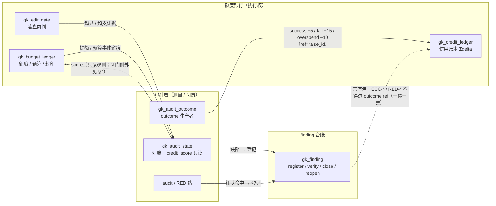
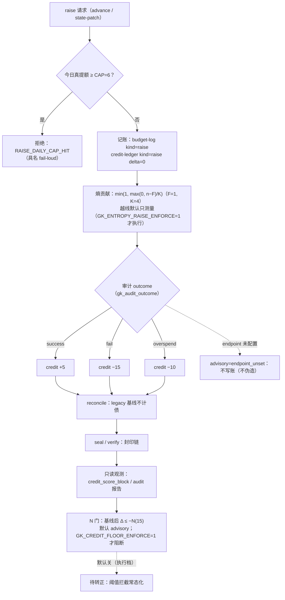
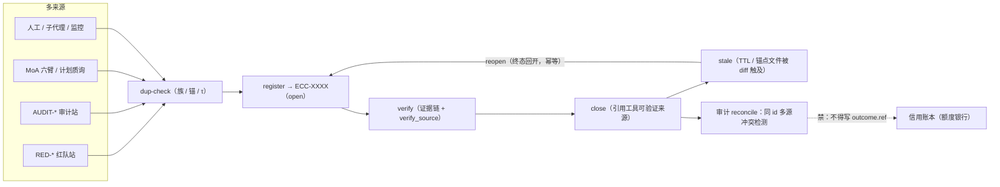

# 信用分与额度银行（Credit Economy）

**定位**：额度银行（budget/credit bank）的**经济面**正本。回答三件事：钱从哪来（提额/豁免的代价）、
分怎么记（旁挂信用账本）、谁有权动（额度银行 vs 审计署分权）。

**边界（先读）**：默认配置下 `score` **不参与任何门禁判定**；唯一消费 = `gk_audit_state.credit_score_block`
（`authority: read_only`，审计报告字段），账本不可用时只降级为 `available:false`，不拖垮审计。
**例外**是显式开启的 N 门：`gk_advance._credit_floor_eval` 在 `GK_CREDIT_FLOOR_ENFORCE=1` 时按
「基线后 `Δ ≤ −N`」阻断（默认只落 advisory），且只认 `econ_enabled_at` / credit 签名基线**之后**的增量
（无基线不得按 `score` 绝对值判，否则一开即锁）。

## 零、为什么要显式建模（经济学隐喻 + 计算机类比）

**问题不在"有没有债"，而在"债在水面下"。** 未被计量的预支、隐式承诺、延期维护都不会自己消失，
只会以三种方式结算：爆雷（一次性清算）、静默降级（慢慢烂）、或挤占后续预算（借新还旧）。

**经济学侧**：显式建模 = 把**表外负债**搬进资产负债表。

| 隐喻 | 本仓对应 | 为什么必须显式 |
|:--|:--|:--|
| 表外负债 / 隐性担保 | 未登记的写、未计价的返工、口头"下轮再修" | 不占额度、不进报表 ⟹ 只在爆雷时才被看见 |
| 会计科目 / 对手方 | `budget` 域、`credit-ledger` 条目、`finding` 台账 | 有科目才能归因，有对手方才能对账 |
| 到期日 / 分期 | R 相位、预算窗口、提额生命周期 | 看得见的债才能展期；看不见的债只能清算 |
| **化债** | **显式建账 + 定价 + 分期**，不是消灭债务 | 债务不可怕，**不可见**才可怕 |

**计算机侧**：同一个问题的技术名字是**隐式状态**（implicit state）与**技术债**（technical debt）。

| 概念 | 本仓对应 | 说明 |
|:--|:--|:--|
| 隐式状态 | 未落库的写、被 `2>/dev/null` 吞掉的失败、并发丢更新 | 运行时才知道 ⟹ 不可观测、不可复现、不可审计 |
| 显式账本（ledger） | `.credit-ledger.jsonl`（append-only、单写者、checksum 对账） | 类似 WAL：先记账再结算，崩溃后可重放 |
| 物化视图（materialized view） | `score = Σ delta`、`audit` 的只读聚合 | 读到的是**已结算事实**，不是临时推断 |
| 观测性三件套的治理版 | metrics=额度用量 / logs=finding 台账 / traces=批次归属 | 缺任一项，"钱去哪了"就答不出来 |
| 技术债的利息 | 预算被重试/返工吃掉、finding 回开率 | 不记账 ⟹ 利息滚进"感觉变慢了" |

**一句话**：**把水面下的经济流动搬到水面上，才能定价、分期、化债**；在系统里，这就叫
**把隐式状态变成可对账的显式账本**。跑得越快，越需要这张账本——否则"跑出一堆债"只会以
静默失败和额度透支的方式出现。

## 一、载体与不变量

| 载体 | 形态 | 说明 |
|:--|:--|:--|
| 账本 | `<state>.credit-ledger.jsonl` | **append-only**；按 **state 文件**（非会话）计 ⟹ `score = Σ delta` 天然跨会话 |
| 封印 | `<state>.credit-ledger.jsonl.seal` | 完整性封印；实现**单源**复用 `gk_budget_ledger` |
| 历史基线 | `<state>.credit-ledger.baseline.json` | 签名基线（cutoff raise id）：`id <= cutoff_id` 划为 legacy，不进待审债 |

不变量：
1. **旁挂**：三类载体都**不参与** `state-patch` 的整体替换（与主 state 生命周期解耦）。
2. **单一实现**：写侧 `gatekeeper-cli.sh::_credit_log_append` 与读侧检查全部委托 `scripts/gk_credit_ledger.py`；
   禁第二套计分/对账实现（`credit_score_block` 也不重算，只读该模块的 `read_records`）。
3. **不静默计分**：JSON 解析失败 / 非对象 / `delta` 非整数 ⟹ 记 `bad`，**不计入** score（C4 同口径）。
4. **产物名用连字符**（`.credit-ledger.jsonl`），逻辑面用下划线（`gk_credit_ledger`）——
   消费者侧的活体/旁挂判别必须按此区分，否则会把封印当域 state 写坏（见 `gk_finding._is_live_ledger_name`）。

## 二、定价（非对称）

| kind | delta | 语义 / 生产者 |
|:--|--:|:--|
| `raise` | **0** | 提额事件：只登记"何时提了额"，本身中性；成败分由审计署后续以 `success`/`fail` 回填 |
| `success` | **+5** | 被审计变更落地且声明的验证通过（outcome producer） |
| `fail` | **−15** | 审计判失败 |
| `overspend` | **−10** | 超支（额度越界使用） |
| `exempt` | **−1 / 项** | L2 入站门 `--acknowledge-injected` 逐项豁免的代价 ⟹ "整表豁免"不零成本 |
| `bookkeeping` | **0** | 预算记账（提额/覆盖留痕），**不是审计事件**；`reconcile` 不计债 |

非对称是刻意的：失败代价 = 成功收益的 3 倍，避免"多试几次总能捞回分"。

## 三、与 ECC-FINDING 的边界（重要）

- **finding 不带经济字段**：finding 记录里没有 credit/score/disposition。
  `gk_finding` 的 `score = Σ severity` 是**根因排序分**，与信用分无关，勿混。
- **finding 禁止被计价**：`gk_credit_ledger._FINDING_ID_RE` 识别 `ECC-<hex>` / `RED-<PHASE>[-NN]`，
  `outcome.ref` 指向这些形态即拒绝写入 —— 防「一债一票」被双边计价（同一缺陷在 finding 台账与
  信用账本各记一次账）。finding 是**禁止被计价**的对象，不是计价主体。
- **监管关系**：审计署出 finding 追责，额度银行据账本动额度；二者不共享写权限。

## 四、归属与分权

| 角色 | 拥有 | 不拥有 |
|:--|:--|:--|
| **额度银行**（`gk_budget_ledger` / `gk_credit_ledger` / `gk_edit_gate`） | 记账、封印、免费额度、单次成本、每日上限、拒绝 raise | 不得改写审计证据、不得自行关闭 finding |
| **审计署**（`gk_audit_state` / `gk_audit_outcome`） | 测量、对账、出 finding、回收（reconcile） | **不直接产生 BLOCK** |
| **monitor** | 测量与留痕（信用分纳入报告） | 归属（M1/M2/M3）与是否保留硬阻断 = 待裁 |

## 五、命令

```bash
python3 scripts/gk_credit_ledger.py score      --state .gatekeeper.state   # 只读 Σdelta
python3 scripts/gk_credit_ledger.py verify     --state .gatekeeper.state   # 校验封印链
python3 scripts/gk_credit_ledger.py reconcile  --state .gatekeeper.state   # 对账（legacy 不计债）
python3 scripts/gk_credit_ledger.py replay-report --state .gatekeeper.state
bash gatekeeper-cli.sh audit                   # 报告内 credit_score 字段（authority=read_only）
```

## 六、失败模式

| 失败 | 表现 | 处置 |
|:--|:--|:--|
| 账本半写/坏行 | `bad > 0`，该行不计分 | `verify` 看封印；必要时 `reconcile` |
| 封印失配 | `seal_ok=false` | 先查是否被外部改写；不重算覆盖 |
| 封印被当域 state | `--domain credit-ledger.jsonl.seal` 可解析 ⟹ 写入即毁封印 | 活体/旁挂判别（`_is_live_ledger_name`） |
| 账本不可用 | `credit_score_block.available=false` | 审计降级继续，不阻断 |
| 历史机械债 | 224 条 `kind=raise` 非真提额 | 签名基线划 legacy（`baseline-write`） |

## 七、已落刀 / 默认关（勿当现状）
- **参数与机制已落刀**（owner 2026-10-31 签 §8 #4，单源 `scripts/gk_econ_params.py`）：
  `F=1` / `K=4` / `CAP=6` / `N=15`；分段熵 `min(1, max(0, n−F)/K)` 已接 `gk_gate_entropy`；
  每日真提额上限以具名 `RAISE_DAILY_CAP_HIT` 拒绝（`gk_budget_ledger`）。
- **默认关的是"执行档"，不是未实现**：
  · 提额驱动的熵越线 ⟹ 默认只测量，`GK_ENTROPY_RAISE_ENFORCE=1` 才阻断
    （`rejected_edits` 驱动的越线仍按既有语义硬阻断）；
  · 信用分 N 门 ⟹ 默认 advisory，`GK_CREDIT_FLOOR_ENFORCE=1` 才阻断。
- `success(+5)` 生产端 = `gk_audit_outcome`（`produce` / `sweep`），**endpoint 必须显式配置**
  （`GK_AUDIT_OUTCOME_ENDPOINT` 或 `--endpoint`，**没有默认**）；未配置只返回
  `advisory=endpoint_unset`，不伪造 success ⟹ 该时点 score 仍单调不增。
- monitor 归属与是否保留 `PRM_MONITOR_BLOCKED` 仍待裁（M1/M2/M3 未落）。

## 八、闭环与生命周期（环图）

> 读图约定：**实线 = 已实现**；**点线 = 约束或未启用**（禁写 / DRAFT / 待裁）。

### 8.1 三角内循环：额度银行 ↔ 审计署 ↔ finding



要点：**写信用分的唯一入口是审计署的 outcome 生产者**；额度银行读 score 做额度动作；
finding 与账本之间**没有**直达边 —— 这条缺失的边本身就是约束（防同一缺陷被双边计价）。
唯一读到门禁的是 `gk_advance._credit_floor_eval` 的 N 门，且**默认只 advisory**。

### 8.2 提额全生命周期（从申请到封印）



要点：`raise` 本身 **delta=0**（只是事件留痕），真正的分值在 outcome 回填时才产生；
`reconcile` 只对账、不重算，历史机械债由签名基线划 legacy；上限（CAP）在**写账前**拒绝，
N 门在**读侧**按基线后增量判，二者都不看 score 绝对值。

### 8.3 finding 多来源闭环（登记 → 复核 → 关闭 → 回开）



要点：多来源收敛靠 `dup-check`（族/锚/τ）+ 同 id 多源冲突检测；`reopen` 是**幂等的终态回开**，
不是新 id；关闭必须引用工具可验证的来源，否则只是"写了句话"。

设计正本（决策与参数）：`docs/plans/2026-10-31-credit-economic-control-plan.md`、
`docs/plans/2026-10-30-credit-score-disposition-plan.md`、
`docs/plans/2026-09-18-edit-budget-dual-track-plan.md` 的 R1-b 段（`docs/` 不随公开包发布）。
